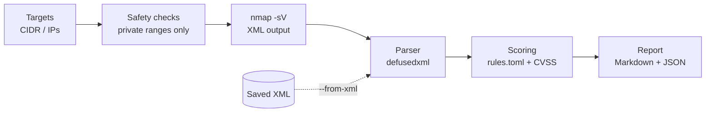

# vuln-scan-automation

A small Python tool that wraps **Nmap**, scans a lab subnet, parses the XML
output and produces a **prioritised Markdown and JSON report**. It is built for
lab and home networks, and it refuses to scan anything else unless you
explicitly override it.

Every address and hostname in this repository comes from documentation
ranges (`192.0.2.0/24`) and the reserved `lab.example` domain. A test fails the
build if a public IP address is ever committed.

## What it does



1. **Safety checks** accept only literal IPs and CIDR ranges in private,
   loopback or link-local space, cap the number of addresses, and require
   `--authorised`.
2. **Scan** runs `nmap` as an argument list (never through a shell) with a
   timeout.
3. **Parse** reads the XML with `defusedxml`.
4. **Prioritise** scores each open port 0-10 from editable rules, plus the
   highest CVSS score when the `vulners` script is used.
5. **Report** lists hosts and findings highest risk first, with remediation.

See [`docs/sample-report.md`](docs/sample-report.md) for real output generated
from the bundled sample scan.

## Install

Requires Python 3.11+ and, for live scans, [Nmap](https://nmap.org/).

```bash
git clone https://github.com/OWNER/vuln-scan-automation.git
cd vuln-scan-automation
python -m venv .venv && source .venv/bin/activate
pip install -e ".[dev]"
```

## Usage

```bash
# Try it without scanning anything:
vulnscan --from-xml tests/fixtures/sample_scan.xml

# Scan your own lab subnet (you must confirm permission):
vulnscan 172.28.0.0/24 --authorised

# Faster, shareable output with addresses and names replaced by labels:
vulnscan 172.28.0.0/24 --authorised --profile quick --redact

# Use in CI: exit status 2 if anything High or above is found
vulnscan --from-xml scan.xml --fail-on high
```

Reports are written to `./reports/` (git-ignored).

| Option | Meaning |
|--------|---------|
| `--profile quick\|standard\|thorough` | Port coverage: top 100, top 1000 (default), all TCP |
| `--vulners` | Add CVE data via the Nmap `vulners` script (needs internet access) |
| `--redact` | Replace addresses, hostnames and banner details with labels |
| `--rules FILE` | Use your own scoring rules |
| `--fail-on LEVEL` | Exit 2 if any finding is at or above `critical`, `high`, `medium` or `low` |
| `--allow-public` | Permit non-private ranges. Only for networks you own or have written permission to test |
| `--save-xml` | Also keep the raw Nmap XML (ignored with `--redact`) |

The identity lab in this portfolio uses `172.28.0.0/24`, which makes a handy
first target.

## How findings are scored

- Each open port is matched against `src/vulnscan/rules.toml` by port or
  service name. Examples: Telnet 9.0, unauthenticated-by-default datastores
  8.0, FTP 7.0, RDP 6.5, SMB 6.0, plain HTTP 3.0, SSH 1.5.
- Clear-text rules are skipped when the service is wrapped in TLS.
- End-of-life product checks (for example Apache 2.2) raise the score.
- If `vulners` reports CVEs, the highest CVSS score is used when it is higher.
- A host's score is its worst finding plus up to 1.0 when several findings are
  Medium or above.
- Bands: Critical 9+, High 7+, Medium 4+, Low 2+, Info below 2.

Scores describe **exposure**, not proof of a vulnerability. This tool does not
test authentication, run exploits or replace a full scanner such as OpenVAS.
Edit `rules.toml` to match your own environment.

## Responsible use

Only scan systems you own or have written permission to test. The tool
enforces private ranges by default, rejects hostnames, caps the target count
and requires `--authorised`, but the responsibility stays with you.

## Development

```bash
pytest -q          # 36 tests, no Nmap needed
ruff check . && ruff format --check .
```

Tests cover target validation, command construction, parsing (including
XML entity-expansion attacks), scoring, report output, redaction, the CLI and
the no-real-addresses guard.

## Roadmap

- OpenVAS/GVM backend behind the same report format
- HTML report and trend comparison between scans
- Scheduled scans with a diff of new findings

## Licence

MIT
